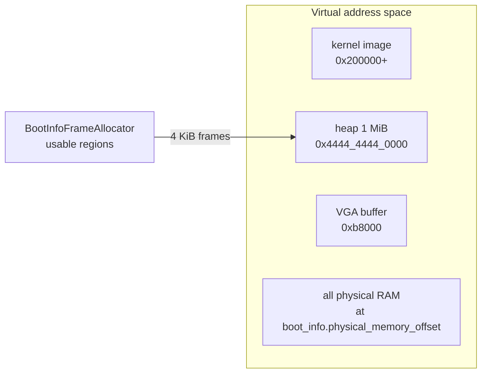

<div align="center">

```text
 ____            _    ___  ____
|  _ \ _   _ ___| |_ / _ \/ ___|
| |_) | | | / __| __| | | \___ \
|  _ <| |_| \__ \ |_| |_| |___) |
|_| \_\\__,_|___/\__|\___/|____/
```

**A from-scratch x86_64 kernel in Rust: BIOS boot, heap, async executor, PS/2 keyboard, and a tiny shell.**

[](https://github.com/DakodaStemen/RustOS/actions/workflows/build.yml)
[](LICENSE)

</div>

## Quickstart

```bash
rustup show                      # picks up nightly from rust-toolchain.toml
cargo install bootimage
sudo apt install qemu-system-x86 # or your OS equivalent
cargo bootimage --release
qemu-system-x86_64 -drive format=raw,file=target/x86_64-unknown-none/release/bootimage-rust-os.bin
```

Or just `cargo run --release` (the `.cargo/config.toml` runner is `bootimage runner`, which builds the image and launches QEMU).

Then type `help` at the `rustos>` prompt.

> [!NOTE]
> Needs the pinned nightly (`rust-toolchain.toml`) with `rust-src` and `llvm-tools-preview`; `rustup` installs them automatically.

## Features

| Area | What exists | Where |
|---|---|---|
| Boot | BIOS boot via `bootloader` 0.9 / `bootimage` | `Cargo.toml` |
| CPU exceptions | GDT + TSS, IDT, double-fault on its own IST stack | `src/gdt.rs`, `src/interrupts.rs` |
| Memory | Physical-memory-offset paging, boot-info frame allocator, 1 MiB linked-list heap | `src/memory.rs`, `src/allocator.rs` |
| Interrupts | 8259 PIC remap, timer tick counter, PS/2 keyboard IRQ | `src/interrupts.rs` |
| Async | Waker-based cooperative `Executor` (task ids, `ArrayQueue` wake queue, `hlt` when idle) + scancode stream task | `src/task/` |
| Shell | `help ticks uptime mem echo clear version reboot shutdown`, Up/Down command history (16 entries) | `src/shell.rs` |
| Output | VGA text mode (with backspace) mirrored to COM1 serial | `src/vga_buffer.rs`, `src/serial.rs` |
| Tests | In-kernel `#[test_case]` suite (`cargo test`) + QEMU shell integration test, both in CI | `src/tests.rs`, `src/shell.rs`, `tests/qemu_test.py` |

> [!IMPORTANT]
> Multitasking is **cooperative only**. Timer-driven preemptive round-robin scheduling is **not implemented**; see [Known limitations](#known-limitations--roadmap).

## Shell commands

| Command | Effect |
|---|---|
| `help` | list commands |
| `ticks` / `uptime` | PIT timer ticks / approximate uptime in ms |
| `mem` | heap used/free/total and usable RAM / frames allocated |
| `echo <text>`, `clear`, `version` | as named |
| `reboot` | pulse the keyboard-controller reset line (QEMU `-no-reboot` exits instead) |
| `shutdown` | ACPI power-off via QEMU ports `0x604`/`0xB004` (only works under QEMU) |
| ↑ / ↓ | walk command history (16 entries, blanks and repeats skipped) |

## Boot flow

```mermaid
flowchart TD
    A[BIOS] --> B[bootloader 0.9<br/>long mode + page tables]
    B --> C[kernel_main]
    C --> D[serial::init]
    D --> E[gdt::init + interrupts::init_idt]
    E --> F[memory::init + 1 MiB heap]
    F --> G[enable interrupts]
    G --> H[shell::init]
    H --> I[Executor::run]
    I --> P{woken task?}
    P -- yes --> Q[poll keyboard task]
    Q --> L[key -> shell line editor / history -> command]
    L --> P
    P -- no --> S[enable_and_hlt]
    S -. IRQ .-> P
    J[IRQ0 timer] -. increments tick counter .-> S
    K[IRQ1 keyboard] -. push scancode into ArrayQueue, AtomicWaker.wake .-> P
```

## Memory map



## Testing

| Command | What it does | Result I observed when preparing this change |
|---|---|---|
| `cargo test` | Custom test framework: boots a test image in QEMU, each `#[test_case]` reports over serial, `isa-debug-exit` sets QEMU's exit status (33 = pass) | 12 tests ok |
| `make test` (= `cargo bootimage --release` + `python3 tests/qemu_test.py`) | Boots the release image headless, types commands via the QEMU monitor, asserts on serial output | all checks passed |

The QEMU script checks: boot banner, prompt, `echo`, `version`, timer ticks, unknown command, `mem` (heap ≥ 1 MiB), history Up/Down, and that `reboot` / `shutdown` terminate QEMU. Both run in CI.

## Layout

```text
src/main.rs        entry point and init order
src/interrupts.rs  IDT, PIC, timer + keyboard handlers
src/shell.rs       line editor and commands
src/task/          waker-based executor, keyboard stream
src/tests.rs       in-kernel #[test_case] tests (cargo test only)
src/qemu.rs        isa-debug-exit, power-off, reboot
tests/             QEMU shell integration test
docs/              ARCHITECTURE, ROADMAP, DEEP_DIVE (long-form notes)
```

## Known limitations / roadmap

| Item | Status |
|---|---|
| Preemptive scheduling (timer-driven context switch) | Not implemented; executor is cooperative |
| Userspace / ring 3, syscalls | Not implemented |
| `bootloader` 0.9 → 0.11 migration (UEFI, newer boot protocol) | Not done; 0.9 is BIOS-only |
| Frame deallocation | `BootInfoFrameAllocator` never frees frames |
| Heap | Fixed 1 MiB, `linked_list_allocator`; no growth, fragmentation possible |
| Timer | Default PIT rate (~18.2 Hz), so `uptime` is coarse |
| Keyboard | PS/2 only, US layout, no USB |
| Shell | No cursor movement/line editing beyond backspace; `shutdown` only works on QEMU/ACPI-compatible emulators |
| Executor | Wake queue holds 100 ids; a full queue panics |

See also [docs/ROADMAP.md](docs/ROADMAP.md).

## More

- [Architecture](docs/ARCHITECTURE.md) · [Roadmap](docs/ROADMAP.md) · [Deep dive](docs/DEEP_DIVE.md) · [Troubleshooting](TROUBLESHOOTING.md) · [Contributing](CONTRIBUTING.md)
- Builds on Philipp Oppermann's [Writing an OS in Rust](https://os.phil-opp.com/).

License: MIT
