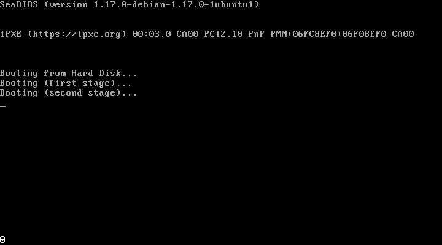
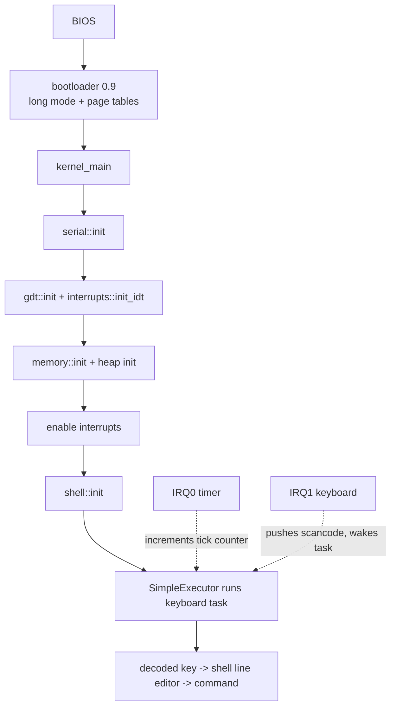

<div align="center">

```text
 ____            _    ___  ____
|  _ \ _   _ ___| |_ / _ \/ ___|
| |_) | | | / __| __| | | \___ \
|  _ <| |_| \__ \ |_| |_| |___) |
|_| \_\\__,_|___/\__|\___/|____/
```

**A from-scratch x86_64 kernel in Rust: BIOS boot, heap, async executor, PS/2 keyboard, and a tiny shell.**

[](https://github.com/DakodaStemen/RustOS/actions/workflows/build.yml)
[](LICENSE)



<sub>Real recording: QEMU boots the image, keys are injected through the QEMU monitor, frames are screendumps. Regenerate with `python3 tests/record_demo.py`.</sub>

</div>

## Quickstart

```bash
rustup show                      # picks up nightly from rust-toolchain.toml
cargo install bootimage
sudo apt install qemu-system-x86 # or your OS equivalent
cargo bootimage --release
qemu-system-x86_64 -drive format=raw,file=target/x86_64-unknown-none/release/bootimage-rust-os.bin
```

Then type `help` at the `rustos>` prompt.

> [!NOTE]
> Needs the pinned nightly (`rust-toolchain.toml`) with `rust-src` and `llvm-tools-preview`; `rustup` installs them automatically.

## Features

| Area | What exists | Where |
|---|---|---|
| Boot | BIOS boot via `bootloader` 0.9 / `bootimage` | `Cargo.toml` |
| CPU exceptions | GDT + TSS, IDT, double-fault on its own IST stack | `src/gdt.rs`, `src/interrupts.rs` |
| Memory | Physical-memory-offset paging, boot-info frame allocator, linked-list heap | `src/memory.rs`, `src/allocator.rs` |
| Interrupts | 8259 PIC remap, timer tick counter, PS/2 keyboard IRQ | `src/interrupts.rs` |
| Async | Cooperative `SimpleExecutor` + scancode stream task | `src/task/` |
| Shell | `help ticks uptime echo clear version` | `src/shell.rs` |
| Output | VGA text mode (with backspace) mirrored to COM1 serial | `src/vga_buffer.rs`, `src/serial.rs` |
| Tests | QEMU integration test in CI | `tests/qemu_test.py` |

> [!IMPORTANT]
> Multitasking is **cooperative only**. Timer-driven preemptive round-robin scheduling is **not implemented**; it is still a roadmap item ([docs/ROADMAP.md](docs/ROADMAP.md)).

## Boot flow



## Testing

```bash
cargo bootimage --release
python3 tests/qemu_test.py       # boots QEMU headless, types commands, asserts on serial output
```

The test checks: boot banner, prompt, `echo`, `version`, that the timer tick counter increases, and the unknown-command path. CI runs it on every PR.

## Layout

```text
src/main.rs        entry point and init order
src/interrupts.rs  IDT, PIC, timer + keyboard handlers
src/shell.rs       line editor and commands
src/task/          executor, keyboard stream
tests/             QEMU integration test, demo recorder
docs/              ARCHITECTURE, ROADMAP, DEEP_DIVE (long-form notes)
```

## More

- [Architecture](docs/ARCHITECTURE.md) · [Roadmap](docs/ROADMAP.md) · [Deep dive](docs/DEEP_DIVE.md) · [Troubleshooting](TROUBLESHOOTING.md) · [Contributing](CONTRIBUTING.md)
- Builds on Philipp Oppermann's [Writing an OS in Rust](https://os.phil-opp.com/).

License: MIT
